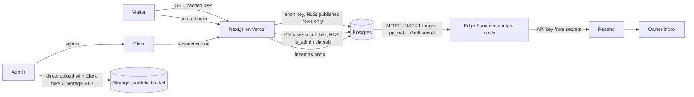
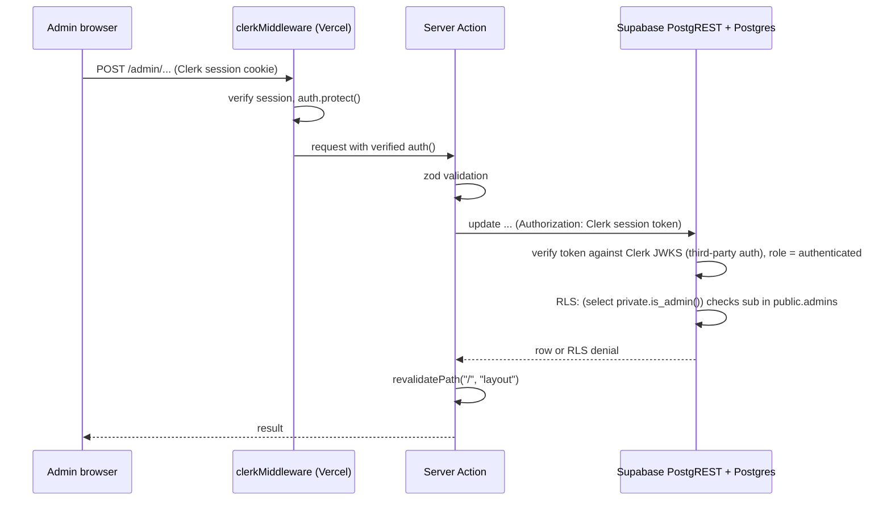

# Arpit Meena · Clerk + Supabase portfolio on Vercel

**Live: [arpitm.me](https://arpitm.me)**

My personal portfolio, built as a small production-shaped **Clerk + Supabase** app
deployed on **Vercel**. It is both the site and a code sample: the Clerk
integration, the schema, Row Level Security policies, Storage rules, the Edge
Function and the tests are all in this repository.

- **Public site** (server-rendered, statically cached with ISR, `revalidate = 300`,
  and revalidated on every admin save with `revalidatePath`): hero, about,
  projects with detail pages, skills, experience timeline and certifications
  (each hidden while empty), contact form and a
  "How this site is built" section. SEO metadata, Open Graph image, JSON-LD,
  sitemap and robots.
- **Admin** at `/admin`: sign-in with **Clerk** (`/sign-in`), protected by
  `clerkMiddleware`. Supabase accepts the Clerk session token through its native
  **third-party auth** integration, so RLS sees the Clerk user ID in
  `auth.jwt()->>'sub'`. Edit the profile, projects, skills and experience, upload
  images and a resume to Storage, and read contact messages.
- **Contact pipeline**: form → Server Action (zod, honeypot, minimum fill time,
  per-IP limit) → `insert` as `anon` (RLS) → Postgres rate-limit trigger → `pg_net`
  trigger → `contact-notify` Edge Function → Resend email.

Stack: Next.js 15 (App Router) on Vercel, React 19, TypeScript, Tailwind CSS v4,
shadcn/ui, Clerk (`@clerk/nextjs`), Supabase (Postgres 17, third-party auth,
Storage, Edge Functions, Vault, pg_net), Vitest, pgTAP.

## Architecture



How an admin write is authorized, end to end:



The app never holds a Supabase service role key: every query runs as `anon` or as
the signed-in Clerk user, so the database policies are the real security boundary.

## How Supabase is used

| Area | What it shows | Where |
| --- | --- | --- |
| Schema | Versioned migrations, check constraints mirroring the app's zod rules, partial indexes on `published` rows, `updated_at` triggers, single-row `profile` table | `supabase/migrations/*_schema.sql` |
| RLS | Enabled on every table. Visitors read only `published` rows; drafts are visible to admins only. Visitors can `insert` contact messages but never read them; column-level grants stop them setting `read_at` | same file |
| Authorization | `public.admins` table of Clerk user IDs (`text`, e.g. `user_2ab…`) + `private.is_admin()` (`security definer`, `search_path = ''`, in a schema the Data API does not expose) that checks `auth.jwt()->>'role' = 'authenticated'` and `auth.jwt()->>'sub'` against `admins`. Called as `(select private.is_admin())` so Postgres evaluates it once per query. Never uses `auth.uid()` (Clerk IDs are not UUIDs) or editable metadata | `supabase/migrations/*_clerk_auth.sql` |
| Abuse protection | `private.enforce_contact_rate_limit()` trigger: 3 messages per email per 10 min and 50 per hour overall, shared by every server instance | same file |
| Storage | Public `portfolio` bucket (5 MiB, images + PDF). Insert/update/delete policies on `storage.objects` only pass for admins. Uploads go straight from the browser with the admin's Clerk session token; no service role key anywhere | `supabase/migrations/*_storage.sql`, `src/components/admin/image-upload.tsx` |
| Auth | Clerk handles sign-in, sessions and MFA; `clerkMiddleware` protects `/admin`. Supabase clients pass the Clerk session token with the `accessToken` option (native integration: no JWT template, no shared JWT secret). `[auth.third_party.clerk]` in `config.toml` mirrors the hosted setting locally | `src/middleware.ts`, `src/lib/supabase/*`, `src/lib/admin.ts`, `supabase/config.toml` |
| Edge Function | Deno function called by a database trigger through `pg_net`, authenticated with a shared secret stored in Vault, timing-safe comparison, HTML escaping, Resend idempotency key | `supabase/functions/contact-notify`, `*_contact_notifications.sql` |
| Tests | pgTAP tests for every policy, the definer function, triggers, Storage and the rate limit; Vitest for validation, helpers and the Edge Function's pure logic | `supabase/tests/database/rls.test.sql`, `src/**/*.test.ts` |
| Resilience | Public pages read with a cookie-free `anon` client (so they stay static) with a 5 s timeout, and fall back to bundled seed content if Supabase is missing or down. Without Clerk keys, Clerk is not loaded at all and `/admin` shows a "configure Clerk" notice | `src/lib/content.ts`, `src/content/placeholder.ts`, `src/lib/env.ts` |

## Environment variables

All of them are listed, with comments, in [`.env.example`](.env.example).

| Variable | Where | Required | Notes |
| --- | --- | --- | --- |
| `NEXT_PUBLIC_SUPABASE_URL` | `.env.local`, Vercel | for live data | `https://<project-ref>.supabase.co` |
| `NEXT_PUBLIC_SUPABASE_PUBLISHABLE_KEY` | `.env.local`, Vercel | for live data | `sb_publishable_…`; or the legacy `NEXT_PUBLIC_SUPABASE_ANON_KEY` |
| `NEXT_PUBLIC_CLERK_PUBLISHABLE_KEY` | `.env.local`, Vercel | for `/admin` | `pk_test_…` (development) / `pk_live_…` (production) |
| `CLERK_SECRET_KEY` | `.env.local`, Vercel | for `/admin` | `sk_test_…` / `sk_live_…`. Server-only, never `NEXT_PUBLIC_` |
| `NEXT_PUBLIC_SITE_URL` | `.env.local`, Vercel | recommended | Canonical URL for metadata, Open Graph, sitemap and robots, e.g. `https://arpitm.me` |
| `NEXT_PUBLIC_SOURCE_REPO_URL` | `.env.local`, Vercel | optional | "Read the source" button; empty hides it |
| `CLERK_DOMAIN` | shell or `supabase/.env` | for the Supabase CLI | Clerk domain used by `[auth.third_party.clerk]` in `config.toml` |

With none of them set the site runs in **preview mode**: it builds and renders the
bundled seed content with a banner, Clerk is not loaded, and `/admin` lists the
missing variables. No Supabase service role key is used anywhere; keep it out of
Vercel.

## Run it locally

Requirements: Node.js 22, Docker (for the local Supabase stack). The Supabase CLI
is a dev dependency, so `npx supabase` works without a global install.

```bash
npm install
cp .env.example .env.local    # fill in the values below as you get them
npm run dev                   # http://localhost:3000 (preview mode until configured)
```

### 1. Create the Clerk application

1. At https://dashboard.clerk.com create an application (this gives you a
   **development** instance). Enable the sign-in methods you want, for example
   email + password or Google.
2. **Configure → Restrictions → Sign-up mode → Restricted**, so nobody but you can
   create an account. Add yourself under **Users → Create user** (or invite
   yourself). The app also renders `<SignIn withSignUp={false} />`.
3. **Configure → API keys**: copy the publishable and secret keys into
   `NEXT_PUBLIC_CLERK_PUBLISHABLE_KEY` and `CLERK_SECRET_KEY` in `.env.local`.

### 2. Enable the Supabase integration in Clerk

Open https://dashboard.clerk.com/setup/supabase, choose the instance and click
**Activate Supabase integration**. This adds the `role: "authenticated"` claim to
Clerk session tokens (Supabase needs it to pick the Postgres role). Copy the
**Clerk domain** it shows, e.g. `happy-cat-12.clerk.accounts.dev`. There is no JWT
template to create: the app sends the normal session token.

### 3. Start Supabase locally with Clerk as third-party provider

`supabase/config.toml` already contains:

```toml
[auth.third_party.clerk]
enabled = true
domain = "env(CLERK_DOMAIN)"
```

so export the Clerk domain before starting the stack (or put
`CLERK_DOMAIN=...` in `supabase/.env`, which is git-ignored). The CLI refuses to
load the config without it.

```bash
export CLERK_DOMAIN=happy-cat-12.clerk.accounts.dev
npx supabase start            # Postgres, PostgREST, Storage, Studio, ... in Docker
npx supabase db reset         # apply supabase/migrations + supabase/seed.sql
npx supabase status           # copy the API URL and publishable/anon key into .env.local
npm run dev
```

### 4. Make yourself admin

Sign in at http://localhost:3000/sign-in. `/admin` then says you are signed in but
not an admin and shows your Clerk user ID (also under **Users** in the Clerk
dashboard). Insert it in Studio (http://127.0.0.1:54323) → SQL editor:

```sql
insert into public.admins (user_id) values ('user_2abc...');
```

Reload `/admin`. If it warns that the token has no `role` claim, the Supabase
integration from step 2 is not active for this Clerk instance.

### Contact emails (local, optional)

```bash
cp supabase/functions/.env.example supabase/functions/.env   # add your Resend key etc.
npm run functions:serve
```

Then tell the database where to send notifications (SQL editor):

```sql
select vault.create_secret('http://api.supabase.internal:8000', 'project_url');
select vault.create_secret('<same value as CONTACT_WEBHOOK_SECRET>', 'contact_webhook_secret');
```

Without these two secrets the trigger does nothing, and messages are still saved.

### Checks

```bash
npm run check        # eslint + tsc + vitest
npm run build        # works with or without env vars
npm run db:test      # pgTAP RLS tests (needs `supabase start` and CLERK_DOMAIN)
npm run db:lint      # Supabase database linter
npm run db:types     # regenerate src/lib/supabase/database.types.ts from the local schema
```

There is no CI workflow in this repository yet; run the commands above locally.

## Deploy (Clerk + hosted Supabase + Vercel, custom .me domain)

1. **Clerk production instance.** In the Clerk dashboard, create the production
   instance for your domain (e.g. `arpitm.me`). Clerk lists DNS records
   (CNAMEs such as `clerk.arpitm.me` and the email records) to add at your
   domain's DNS provider; add them and wait until Clerk shows them verified. Set
   **Restricted** sign-up mode and create your user again (users are per instance).
   Then repeat step 2 above for the production instance
   (https://dashboard.clerk.com/setup/supabase) and note its Clerk domain, e.g.
   `clerk.arpitm.me`.
2. **Supabase project.** Create one at https://supabase.com/dashboard and note the
   project ref, URL and publishable key (Project Settings → API Keys).
3. **Add Clerk as a third-party auth provider in Supabase.** Dashboard →
   Authentication → Sign In / Providers → **Third-Party Auth** → **Add provider** →
   **Clerk**, and paste the production Clerk domain. (For a preview deployment
   using the development instance, add that domain too, or use a separate
   Supabase project.)
4. **Schema and seed**:
   ```bash
   npx supabase login
   npx supabase link --project-ref <project-ref>
   npx supabase db push --include-seed     # migrations + seed content
   ```
   Edit the content later from `/admin`.
5. **Make yourself admin**: sign in once on the deployed site (step 8) to see your
   production Clerk user ID, or copy it from Clerk → Users, then in the Supabase
   SQL editor:
   ```sql
   insert into public.admins (user_id) values ('user_2abc...');
   ```
6. **Edge Function and email**:
   ```bash
   npx supabase functions deploy contact-notify --no-verify-jwt
   npx supabase secrets set RESEND_API_KEY=re_... CONTACT_WEBHOOK_SECRET=<long random string> \
     CONTACT_NOTIFY_TO=you@example.com "CONTACT_NOTIFY_FROM=Portfolio <hello@your-verified-domain>" \
     SITE_URL=https://arpitm.me
   ```
   and in the SQL editor store the Vault secrets the trigger reads:
   ```sql
   select vault.create_secret('https://<project-ref>.supabase.co', 'project_url');
   select vault.create_secret('<same CONTACT_WEBHOOK_SECRET>', 'contact_webhook_secret');
   ```
   With Resend's test sender (`onboarding@resend.dev`) mail is only delivered to
   your own Resend account address; verify a domain for anything else.
7. **Vercel project.** Import the repository at https://vercel.com/new (framework:
   Next.js, defaults are fine; `vercel.json` only pins the framework). Under
   Settings → Environment Variables set, for **Production**:
   `NEXT_PUBLIC_SUPABASE_URL`, `NEXT_PUBLIC_SUPABASE_PUBLISHABLE_KEY`,
   `NEXT_PUBLIC_CLERK_PUBLISHABLE_KEY` (`pk_live_…`), `CLERK_SECRET_KEY`
   (`sk_live_…`), `NEXT_PUBLIC_SITE_URL=https://arpitm.me` and optionally
   `NEXT_PUBLIC_SOURCE_REPO_URL`. For **Preview**, use the Clerk development keys
   (production Clerk keys only work on the production domain). Deploy.
8. **Custom domain.** Vercel → Project → Settings → **Domains** → add
   `arpitm.me` (and `www.arpitm.me`, redirecting to the apex). At the .me
   registrar add the records Vercel shows (an `A` record for the apex and a
   `CNAME` for `www`), or switch the nameservers to Vercel. Vercel issues the TLS
   certificate once DNS resolves. Redeploy if you changed `NEXT_PUBLIC_SITE_URL`,
   then sign in at `https://arpitm.me/sign-in`.

## Security notes

- **No service role key** in the app, in Vercel or in the browser. Public reads use
  the publishable key as `anon`; admin reads and writes use the admin's Clerk
  session token, so RLS applies to every request.
- **Admin rights live in the database**, in `public.admins`, checked by
  `private.is_admin()` (`security definer`, empty `search_path`, in a schema the
  Data API does not expose). Clerk user metadata is never trusted for authorization.
- **Restricted sign-up** in Clerk, and `<SignIn withSignUp={false} />`, so only
  invited users can sign in; signing in alone grants nothing without an
  `admins` row.
- **Contact messages are write-only** for visitors (insert policy, no select), with
  column grants that stop visitors setting `read_at`, plus app- and database-level
  rate limits.
- **Storage writes are admin-only** by policy on `storage.objects`; the bucket is
  limited to 5 MiB images and PDFs.
- **Edge Function** checks a shared secret (from Vault on the database side) with a
  timing-safe comparison and escapes HTML in the email.
- **Security headers** including a Content-Security-Policy are set in
  `next.config.ts`.
- `.env*` files are git-ignored except the `.env.example` templates, which contain
  placeholders only.

## Adding a certificate

Certificates live in `public.certifications` (migration
`*_certifications.sql`): anyone can read published rows, only admins
(`private.is_admin()`) can write. The Certifications section and its nav link
appear once there is at least one published row. Add one from the Supabase SQL
editor:

```sql
insert into public.certifications
  (name, issuer, issued_on, expires_on, credential_id, credential_url, skills, sort_order)
values
  ('Certificate name', 'Issuer', '2025-06-01', null, 'ABC123',
   'https://www.example.com/verify/ABC123', array['Skill one', 'Skill two'], 10);
```

Only `name` and `issuer` are required. To show it in preview mode too, add the
same row to `placeholderCertifications` in `src/content/placeholder.ts` and to
`supabase/seed.sql`.

## Project layout

```
src/app/(site)/          public pages: home, /projects/[slug]
src/app/admin/           admin area (dynamic, per-user)
src/app/sign-in/         Clerk <SignIn /> page
src/app/actions/         Server Actions: contact, admin CRUD
src/components/site/     public sections
src/components/admin/    admin forms, upload, navigation
src/components/ui/       shadcn/ui
src/middleware.ts        clerkMiddleware, protects /admin
src/lib/supabase/        server and browser clients (Clerk session token) + database types
src/lib/                 env, content loading, validation, rate limit, helpers
supabase/                config.toml, migrations, seed.sql, tests, functions
```
